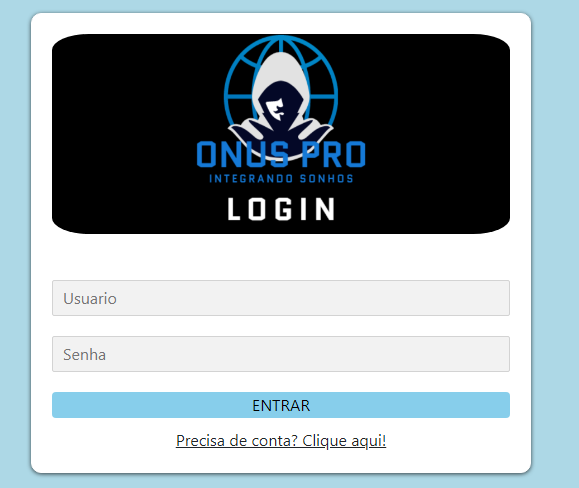
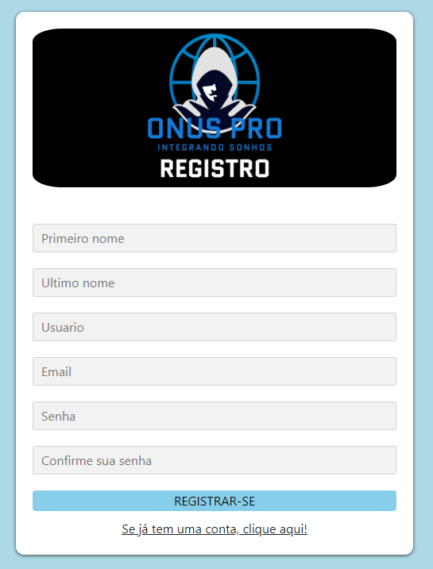
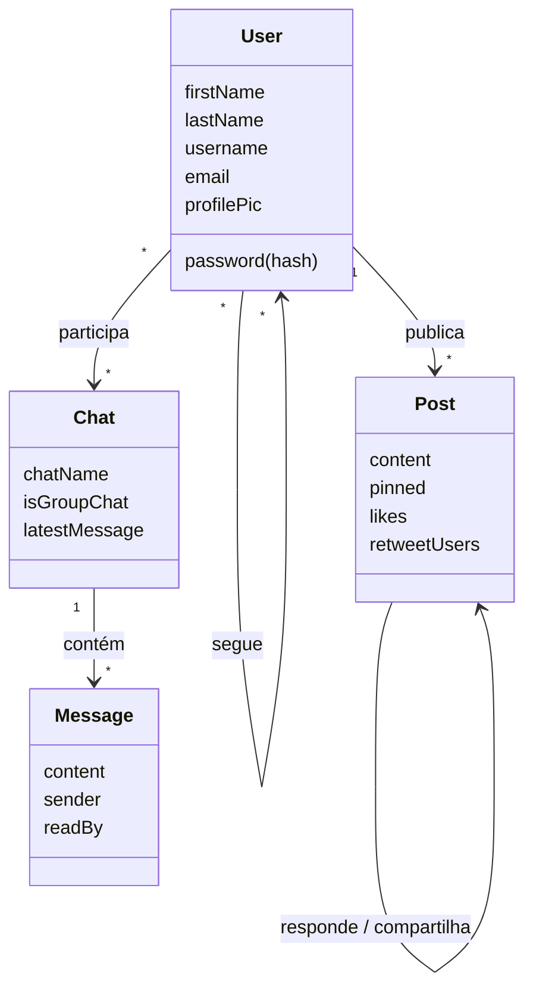

# ONUSPRO – Integrando Sonhos

> Rede social que conecta jogadores amadores de eSports a organizações e recrutadores.
> Projeto desenvolvido como **Trabalho de Conclusão de Curso** do Bacharelado em Sistemas de Informação (Faculdade Projeção, 2024).


<p align="center">
  
  &nbsp;
  
</p>

## O problema

O cenário competitivo de eSports cresce a cada ano, mas entrar nele ainda depende quase só de contatos pessoais. Numa pesquisa com 14 jogadores e CEOs de guildas do cenário amador de Free Fire, **92,9% disseram que encontram novos jogadores apenas por indicação**, e 57,1% usariam uma plataforma dedicada para recrutar jogadores competitivos.

## A solução

O ONUSPRO funciona como uma rede social com foco em carreira: o jogador publica seu "currículo competitivo" (idade, tempo de jogo, função, campeonatos) e as organizações encontram, seguem e conversam com quem tem o perfil que procuram.

## Funcionalidades

- **Cadastro e login** com senha criptografada (bcrypt) e sessão autenticada
- **Feed** para publicar o currículo competitivo
- **Curtir, compartilhar (repost) e responder** publicações, além de excluir as próprias
- **Perfil** com foto personalizada (upload com recorte), abas de publicações e respostas
- **Seguir / deixar de seguir** jogadores e organizações, com listas de seguidores e seguindo
- **Pesquisa** por publicações (ex.: nome do jogo) ou por jogadores
- **Mensagens privadas e chats em grupo** entre jogadores e recrutadores

## Tecnologias

| Camada | Tecnologia |
| --- | --- |
| Back-end | Node.js, Express, express-session |
| Banco de dados | MongoDB (Atlas) com Mongoose |
| Front-end | Pug (templates), JavaScript, jQuery, Bootstrap, Cropper.js, CSS |
| Segurança | bcrypt para hash de senhas, rotas protegidas por middleware |
| Upload | Multer |
| Metodologia | Extreme Programming (XP) |

## Arquitetura

```
onuspro/
├── app.js              # Configuração do Express, sessão e registro das rotas
├── database.js         # Conexão com o MongoDB via Mongoose
├── middleware.js       # Bloqueia páginas internas para usuários não logados
├── routes/             # Rotas que renderizam as páginas (login, perfil, mensagens...)
│   └── api/            # API REST consumida pelo front-end (posts, users, chats, messages)
├── schemas/            # Modelos do banco: User, Post, Chat, Message
├── views/              # Templates Pug (layouts, mixins e páginas)
└── public/             # JavaScript do navegador, CSS e imagens
```

### Modelo de dados



## Como executar

**Pré-requisitos:** Node.js 20.12 ou superior e um banco MongoDB (local ou um cluster gratuito no [MongoDB Atlas](https://www.mongodb.com/atlas)).

```bash
git clone https://github.com/eduardoGuerra56/onuspro.git
cd onuspro
npm install
cp .env.example .env   # preencha MONGODB_URI e SESSION_SECRET
npm start
```

Acesse http://localhost:3003 e crie uma conta em "Precisa de conta? Clique aqui!".

## Próximos passos

- Notificações de curtidas, respostas e novos seguidores
- Mensagens em tempo real com Socket.IO
- Perfis do tipo "Organização" com divulgação de campeonatos amadores

## Autor

**Eduardo Guerra** – Analista de Suporte | Bacharel em Sistemas de Informação

[](https://github.com/eduardoGuerra56)

Veja também: [ONUSPRO Player Management](https://github.com/eduardoGuerra56/onuspro-player-management), a primeira versão do projeto, em PHP.
